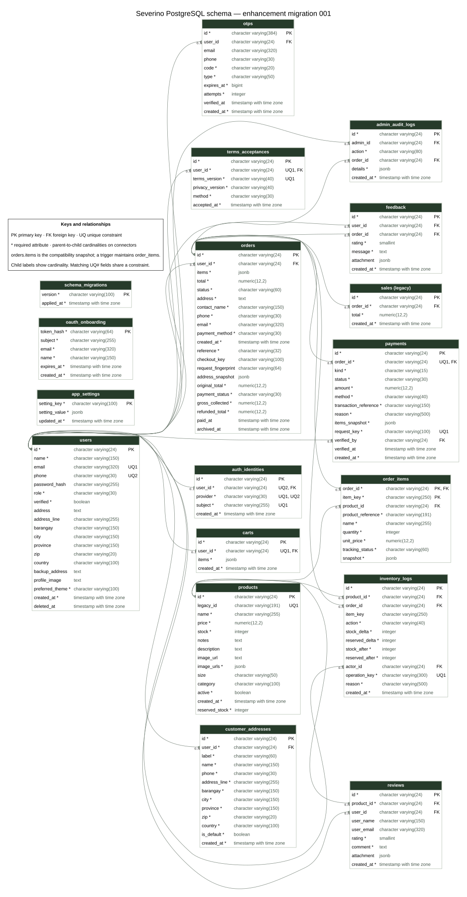
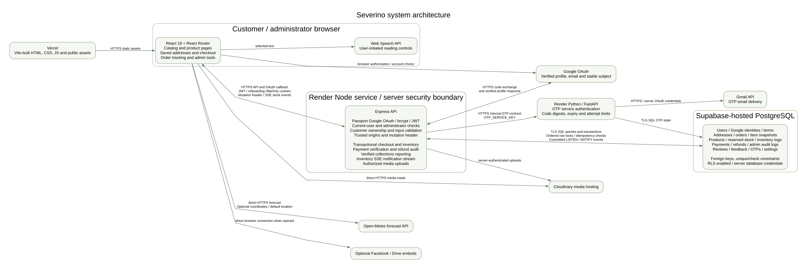
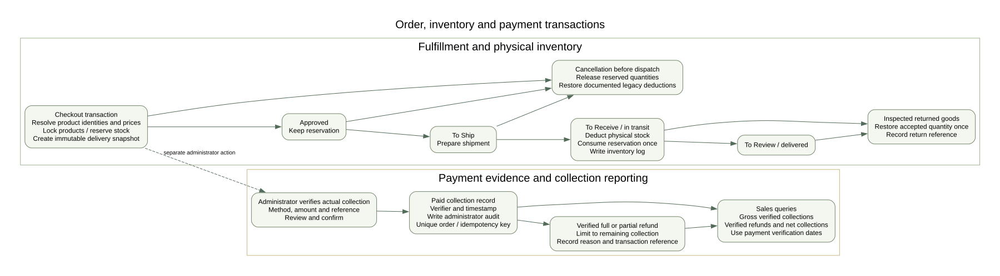

# Severino system design

This document describes the implementation after enhancement migration 001. The diagrams were generated from the migrated PostgreSQL schema and the application routes on November 19, 2026.

## Entity relationships

*Figure 1. The complete 18-table schema, including migration metadata, attributes, primary keys, foreign keys, and cardinalities.*

The editable Graphviz source accompanies the SVG. The database reference lists complete attribute types, nullability, defaults, and indexes. Matching UQ numbers within one entity identify a composite unique constraint. Partial indexes enforce one default address, one collection per order, and duplicate protection for verified transaction references. [Editable ERD](diagrams/entity_relationships.dot), [database reference](DATABASE_SCHEMA.md)

`orders.items` retains the established JSON response representation. PostgreSQL's `orders_sync_items` trigger maintains the relational `order_items` projection within the same transaction. Historical product references can retain a null relational product link when the original product no longer exists. Immutable item snapshots preserve the purchased name, price, quantity, and tracking evidence. New checkout resolves valid products before inserting an order.

`customer_addresses` belongs to users. Orders copy delivery details into `address_snapshot`, so address changes and deletions preserve the delivery record of a completed purchase. Profile address fields and historical backup text support older records. The address book supplies current checkout choices.

`payments` stores collections and refunds, their verification state, method, amount, reference, verifier, and verification time. `payments.items_snapshot` preserves the product allocation used for reporting. Existing `sales` rows remain historical order-placement records. Revenue queries aggregate verified payment activity.

## Architecture and service boundaries

*Figure 2. Frontend hosting, privileged services, PostgreSQL access, authentication, and direct browser integrations.*

Vercel serves the React/Vite frontend. React sends API requests to Express on Render. Express verifies the JWT and current user, checks ownership or administrator access, validates input, and calls PostgreSQL through `pg`. Production cookies are HttpOnly and Secure. Credentialed CORS permits configured frontend origins. Cookie-authenticated mutations also require the application's custom request header.

Supabase hosts PostgreSQL. Application authentication runs through Express, Passport Google OAuth, bcrypt, and JWT. The Node service holds database and OAuth credentials. New business tables enable RLS, and application data access uses the server database connection. The configured server database role can bypass RLS, so Express ownership and role checks govern application access.

For OTP operations, Node calls the Python FastAPI service with the shared service key. Python stores challenge state in PostgreSQL and sends mail through Gmail API. Node brokers authorized uploads to Cloudinary. The browser reads hosted media directly, calls Open-Meteo for enabled forecasts, and connects directly to optional embeds when opened. Speech controls call the browser speech API, which uses the selected browser/platform speech service.

### Google authentication sequence

1. The browser requests `/api/auth/google`. Express creates a random OAuth state cookie and redirects to Google.
2. Google returns an authorization response through the browser to the callback.
3. Express checks state. Passport exchanges the code and retrieves the provider profile. The callback requires a stable provider subject and an explicitly verified email claim.
4. A linked identity receives the application session cookie. An initial identity receives a short-lived opaque onboarding cookie, whose hash identifies server-stored onboarding data.
5. Account completion requires current terms acceptance. A matching password account requires its authenticated account session before linking. A legacy Google account with a verified matching email can acquire its provider identity during onboarding.
6. User creation/linking, terms evidence, and onboarding consumption commit together. Google users receive an application session through the completed identity flow.

## Order, payment, and inventory transactions

*Figure 3. Fulfillment, inventory movements, and verified collection reporting.*

| Operation | Transaction behavior |
| --- | --- |
| Checkout | Lock the checkout key and product rows in deterministic order. Resolve canonical products and database prices. Consolidate quantities, reserve stock, insert the order and snapshots, write inventory logs, and consume purchased cart quantities. |
| Approval / preparation | Advance the guarded fulfillment stage while retaining the reservation. |
| Dispatch | Deduct physical stock and consume the reservation once when the item enters To Receive. |
| Cancellation | Release pending reservations or restore documented legacy deductions for eligible items before dispatch. Recalculate the active payable order total. |
| Returned goods | Verify accepted quantity against outstanding dispatched units. Restore that quantity with an idempotent return reference. |
| Payment verification | Lock the order, verify the full current COD amount and collection evidence, then write the payment, order summary, and administrator audit together. |
| Refund | Lock the order, enforce the remaining verified balance, and record the actual refund and audit evidence. |

Available stock equals physical stock minus reserved stock. Database checks enforce nonnegative physical and reserved balances and constrain reserved quantities to physical stock. Inventory notifications are delivered after commit. Public SSE events prompt storefront stock refreshes. Large notification payloads use a compact refresh event.

Checkout keys are scoped to a customer and paired with a request fingerprint. A matching retry returns the original order. A reused key with changed details is rejected. The browser retains uncertain submissions so it can recover their original result after a lost response or page reload.

Customer requests use public order references and are authorized against the authenticated owner's record. Administrators can archive completed/canceled orders. Account removal disables access while transaction relationships preserve historical orders, payments, and audit evidence.

## Reporting definitions

| Metric | Definition |
| --- | --- |
| Gross collected | Sum of verified collections for included orders. |
| Verified refunds | Sum of verified refund records for included orders. |
| Net collected | Gross collected minus verified refunds. |
| Pending / unpaid | Separate operational counts from order and verified-payment state. |
| Canceled-order refund balance | Verified collections less verified refunds for excluded canceled/removed orders. The dashboard exposes the remaining balance awaiting refund confirmation. |
| Report date | The collection/refund verification date, grouped in Asia/Manila. |
| Product revenue | Verified event amounts allocated proportionally to the immutable item snapshot. Refunds reduce allocated revenue. |
| Product units | Units attached to verified collection snapshots. Physical returns remain recorded in inventory history. |

The dashboard, report history, charts, product rankings, and print output use these payment-based definitions. Archived fulfilled orders retain their verified collection history. Historical payment evidence and policy acceptance timestamps require actual records during reconciliation.

## Responsive behavior

The existing desktop, tablet, and mobile styles are extended with wrapping actions, stacked address cards, order summaries, semantic status badges, and scrollable dialogs. New workflow checks exercise 1440, 768, 390, and 320-pixel layouts. Existing storefront checks also exercise 1024 pixels. The user manual includes representative desktop, tablet, and mobile screenshots. [User manual](USER_MANUAL.md)
