# Severino customer and administrator manual

Revised November 19, 2026 for enhancement migration 001.

The screenshots show the implemented application components with synthetic demonstration accounts, addresses, orders, and collections. The procedures apply to the deployed release after its database migration. Desktop examples introduce the full interface. Tablet and mobile examples appear at the end.

## Customer procedures

### 1. Create an account with email

1. Open **Sign In**, then **Create an account**.
2. Enter your name, email, and Philippine mobile number. Select **Continue**.
3. Select **Send OTP**, enter the six-digit email code, and select **Verify OTP**.
4. After successful verification, continue and enter your Severino password twice.
5. Enter your delivery address and continue to the review step.
6. Open **Read Terms and Conditions** and **Read Privacy Notice**. Select the acceptance checkbox after reviewing them.
7. Select **Create Account**, then sign in with your email or mobile number and Severino password.

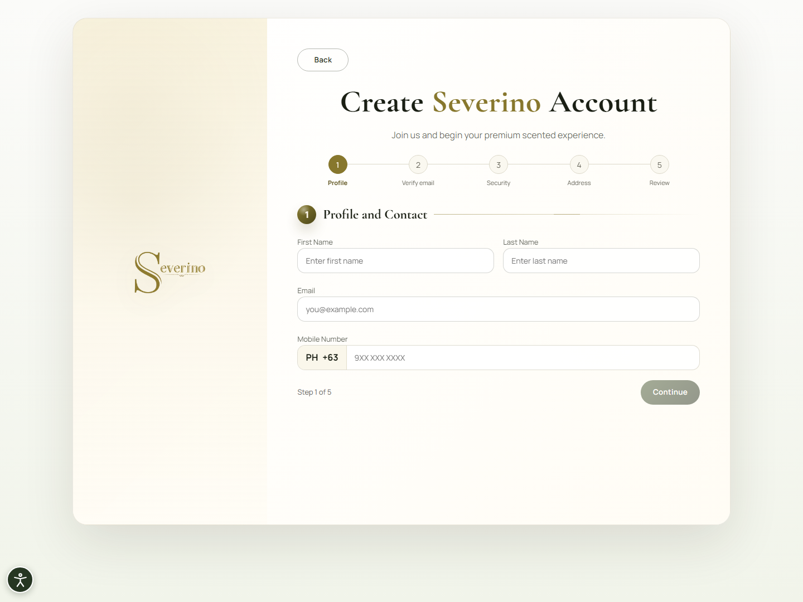

*Figure 1. Registration starts with profile and contact details.*

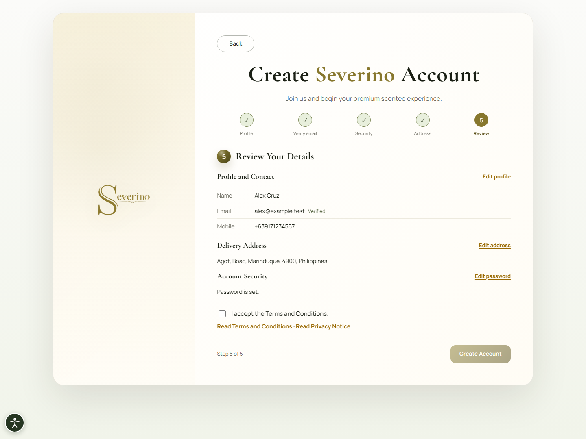

*Figure 2. The review step presents policy links and an initially unchecked acceptance checkbox.*

### 2. Continue with Google

1. Open **Sign In** and select **Continue with Google**.
2. Choose your Google account and follow Google's authorization prompts.
3. On your first visit, review the displayed account, open the policy links, and select the acceptance checkbox.
4. Select **Complete account**.
5. If an existing Severino password account uses the same email, enter that account's existing Severino password to link Google. Future Google sign-ins use the linked identity.

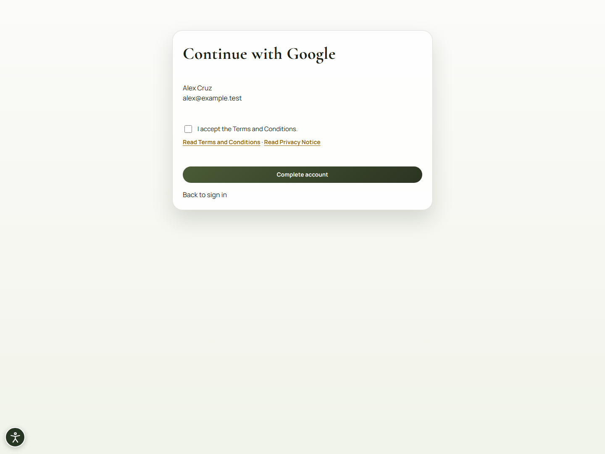

*Figure 3. A new Google customer completes policy acceptance on the account-completion screen.*

### 3. Browse products and add to cart

1. Open **Shop**. Search by product information, choose a category, or change the sort order.
2. Open a product to review its description, scent notes, price, size, and available stock.
3. Select **Add to Cart**, then choose the quantity with the minus and plus buttons.
4. Select **Add to Cart** in the quantity dialog. A success message confirms the addition.
5. Open the cart to review the selected products and quantities.

The increment button stops at the available stock, including units already in your cart. Each product has a maximum cart quantity of 100. Checkout checks availability again.

If older cart entries exceed current limits or refer to unavailable products, select **Update cart availability** to adjust them together before checkout.

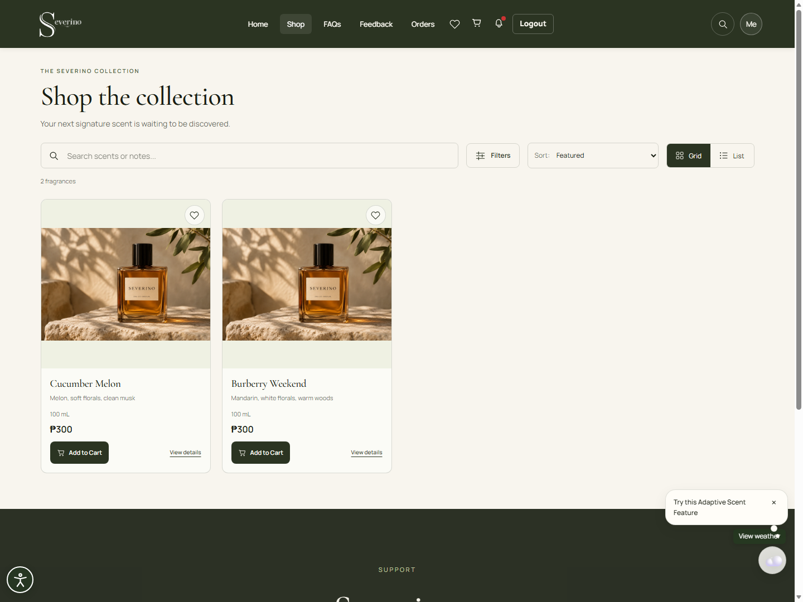

*Figure 4. The catalog provides descriptive product actions and stock feedback.*

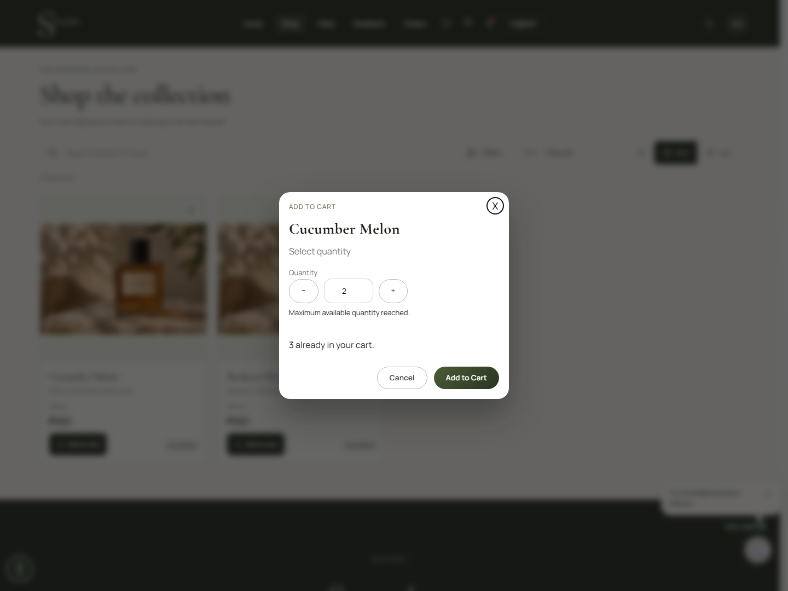

*Figure 5. The quantity dialog accounts for existing cart quantities and disables the increment at its limit.*

### 4. Save and manage shipping addresses

1. Open **Me** to reach **My account**.
2. Find **Shipping addresses** and select **Add New Address**.
3. Enter a label such as Home or Work, the recipient, and their mobile number. Choose the Philippine province or area, then select a city or municipality and one of its barangays. Enter the four-digit ZIP code and any street or house details.
4. Select **Use as default address** when appropriate, then **Save address**.
5. Select **Edit address** to update a saved address or choose another default.
6. Select **Delete address** and confirm to remove an address. Deleting the default promotes another saved address when available.

The personal-information form updates your name, mobile number, and profile photo. Contact Severino for verification of an account email change.

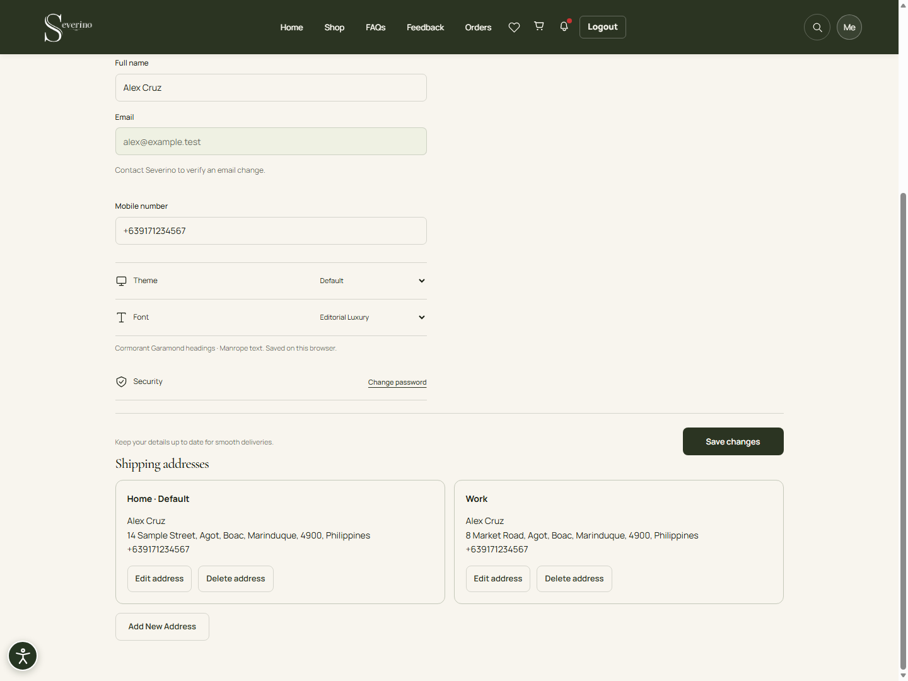

*Figure 6. Customers manage labeled addresses through their account page.*

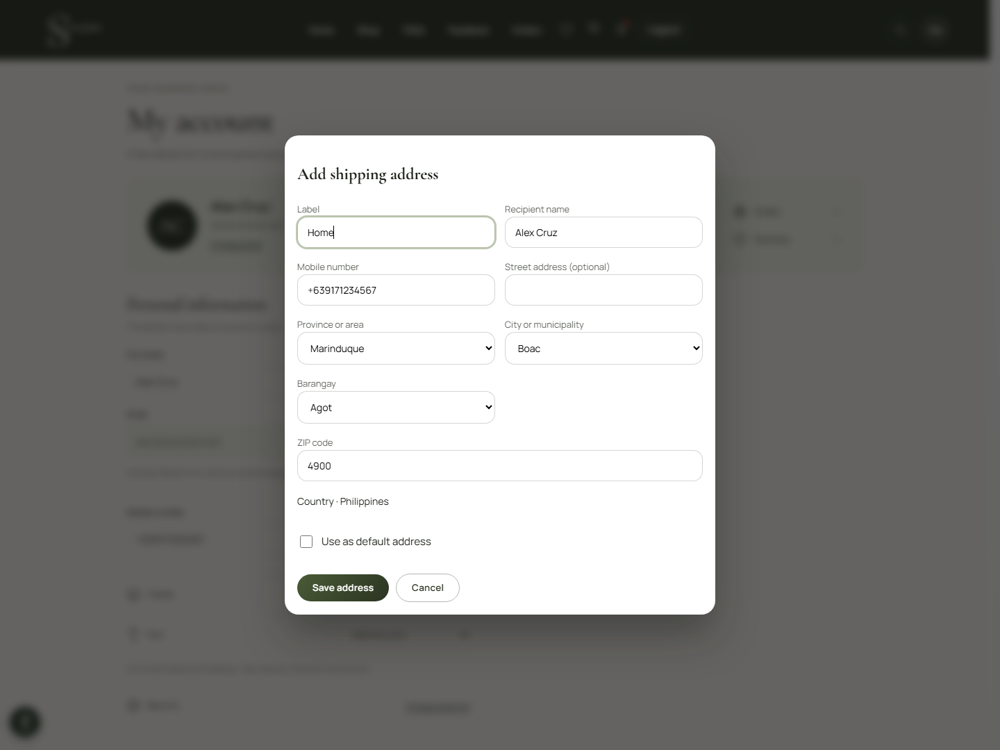

*Figure 6a. Changing the province clears the city and barangay so customers can choose a valid combination.*

### 5. Complete checkout

1. In the cart, select the products to purchase and choose **Continue to Checkout**. **Buy Now** on a product opens checkout for that product.
2. Select a saved address. The default is preselected when available.
3. Use **Add New Address** or **Edit address** when delivery details need changes.
4. Select **Next**, check the contact details, and optionally add delivery notes.
5. Select **Next**, review the delivery details and payment method, then **Confirm Order**.
6. Pay cash when the order is handed over.

If a connection interruption leaves a request awaiting confirmation, use **Retry previous order confirmation**. The retry checks the original submission using its retained checkout reference.

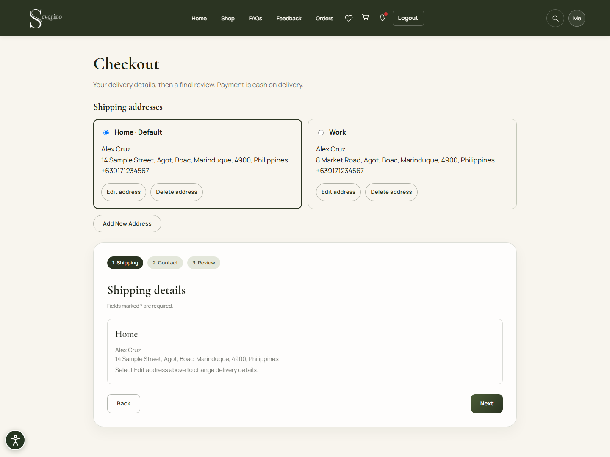

*Figure 7. Checkout presents saved addresses as selectable options.*

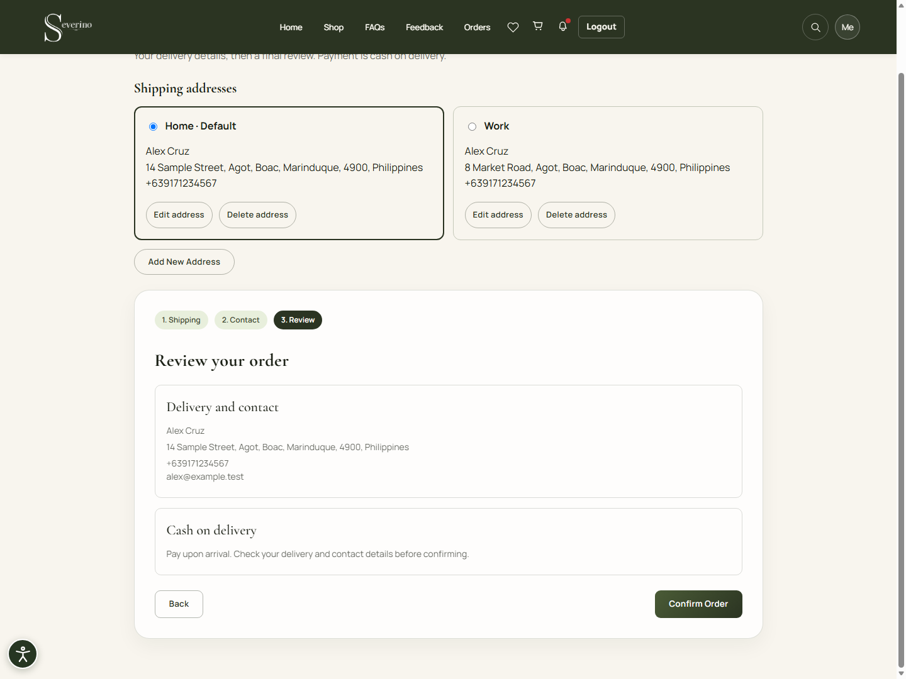

*Figure 8. The review step shows delivery and contact details before order placement.*

### 6. Track an order

1. Open **Orders** and locate the reference beginning with **SV-**.
2. Review the product names and the delivery and payment badges.
3. Expand **View products and tracking** to inspect individual products, delivery details, and tracking events.
4. Select **Cancel item** for an eligible pending item, or **Cancel order** when all active items remain pending. Confirm the cancellation in its dialog.
5. After delivery, use **Buy Again** or **Rate this Product** where available.

Follow the connected stages from left to right on desktop or top to bottom on mobile. The timeline marks the current stage and shows a check beside each completed stage. The delivery stages are Awaiting approval, Approved, Preparing shipment, In transit, and Delivered. The payment badge changes when an administrator verifies collection or a refund.

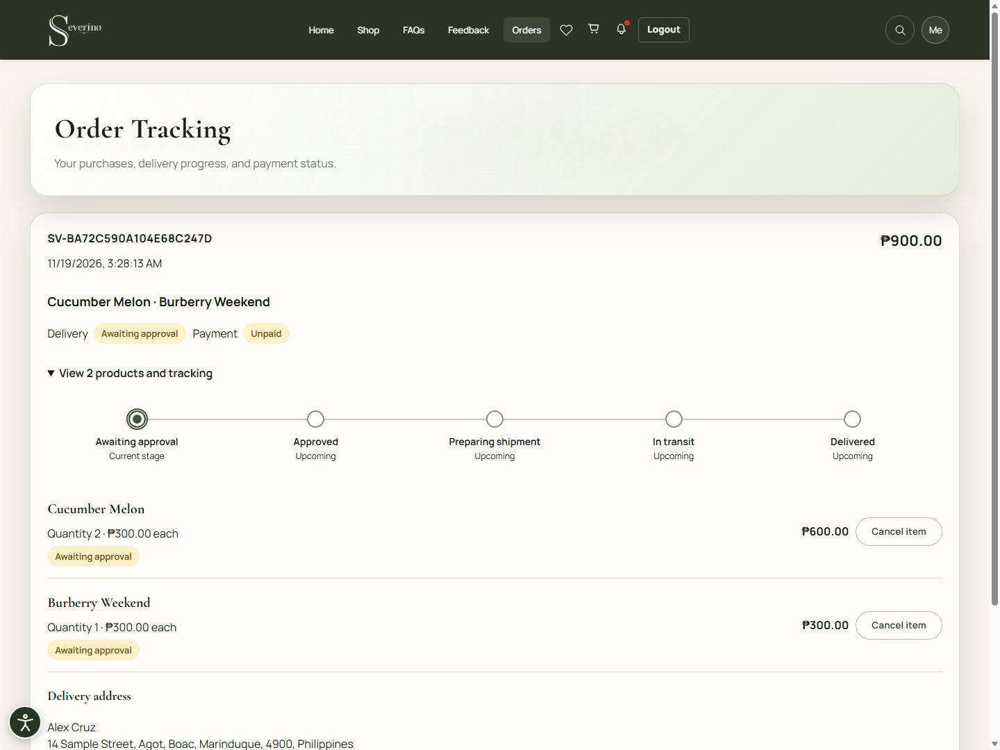

*Figure 9. One order contains its purchased products, tracking timeline, and payment status.*

### 7. Use accessibility and weather controls

Open the round **Accessibility settings** button near the bottom left to adjust keyboard focus, underline links, enlarge text, increase contrast, or reduce motion. The browser remembers your choices. **Reset settings** restores the defaults. Choose **Play** under **Read this page** to hear visible headings and paragraphs. Select a passage before opening the panel to read just that passage. Closing the panel ends that reading.

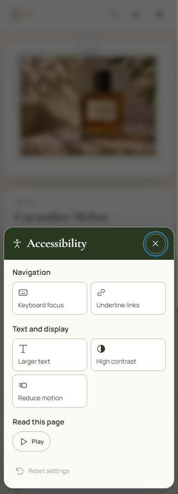

*Figure 9a. The accessibility panel groups reading, display, and navigation controls on mobile.*

1. On a product, FAQ answer, or policy, find **Read aloud** and select **Play**.
2. Select **Pause** and **Resume** to control the current reading. **Replay** restarts it and **Stop** ends it.
3. Starting another section stops the previous reading. An availability message appears when speech is unsupported.
4. On Home or Shop, select **View weather** to open Adaptive Scent. Choose the default forecast or enable location access for local suggestions.

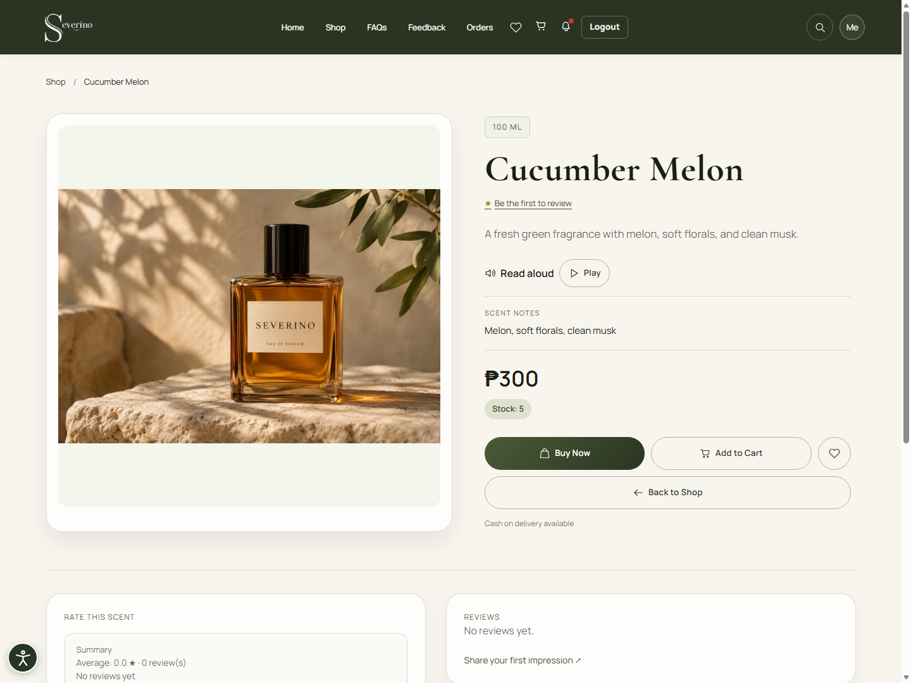

*Figure 10. Product information includes optional speech controls.*

## Administrator procedures

### 8. Process an order

1. Sign in through the administrator login and open **View Orders**.
2. Review the order reference, customer contact information, products, delivery badge, and payment badge.
3. Select **Approve order**, then **Ready to ship**, **Dispatch order**, and **Mark delivered** as the corresponding actions occur.
4. Expand **Products and delivery details** to handle an individual item's next stage or inspect exceptions.
5. For an eligible cancellation before dispatch, select **Cancel order** and confirm.
6. Use **Archive order** for a completed or canceled order when it can leave the active administrator list.

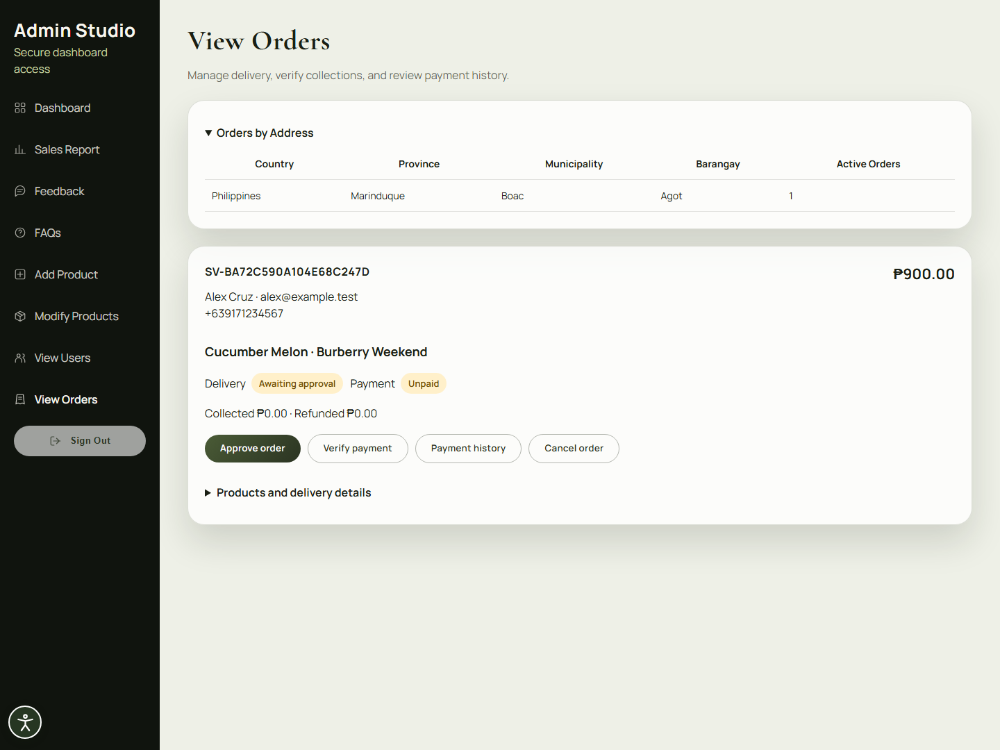

*Figure 11. Administrator controls act on an order while retaining its individual product information.*

### 9. Verify a COD collection

1. Open the order and select **Verify payment**.
2. Choose **Pending Verification**, **Failed**, or **Paid** according to the collection evidence.
3. Check the full order amount and payment method. Enter the collection or transaction reference and relevant notes.
4. For **Paid**, select the checkbox confirming that actual COD collection was verified.
5. Select **Review payment action**, inspect the confirmation, then select **Confirm payment action**.
6. Open **Payment history** to review the recorded action, verifier, reference, and time.

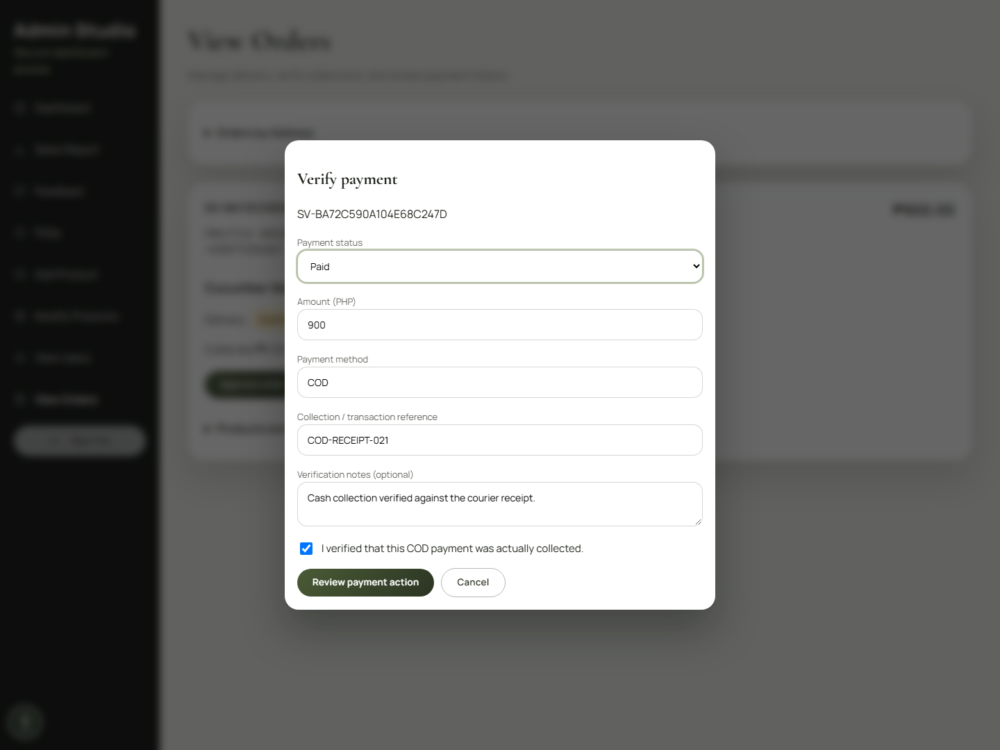

*Figure 12. Payment verification captures collection evidence and explicit administrator acknowledgment.*

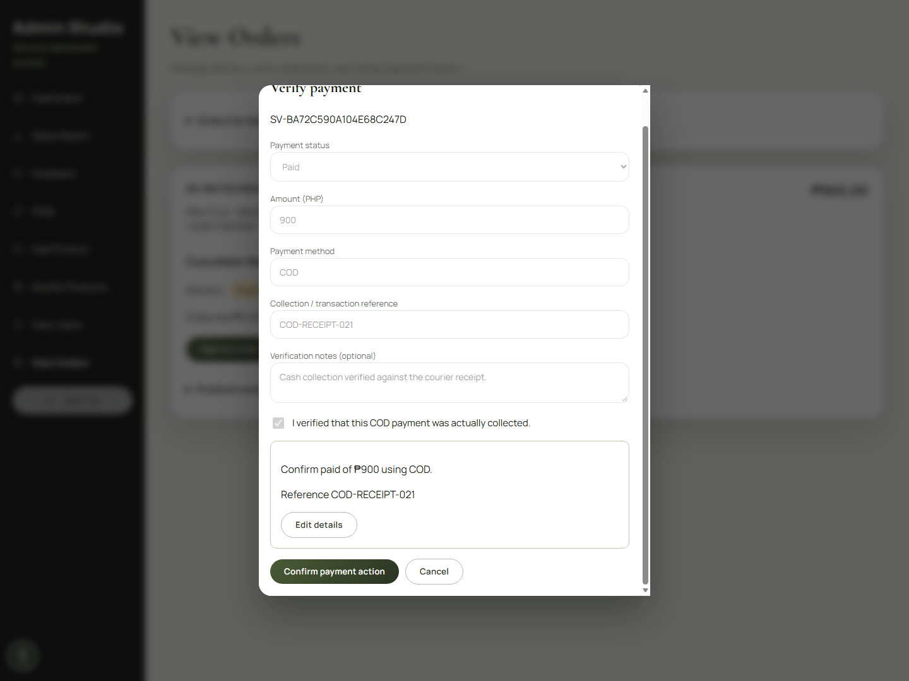

*Figure 13. A separate final action confirms the reviewed payment details.*

### 10. Record a refund or receive returned goods

1. On an order with a remaining verified collection, select **Record refund**.
2. Enter the refunded amount, actual refund method, transaction reference, and reason.
3. Confirm that the refund was paid, review it, and select **Confirm payment action**. The amount is limited to the remaining collected balance.
4. For dispatched goods received back by the store, expand the order and select **Receive returned goods** on the relevant product.
5. Enter the accepted quantity, confirm inspection, and select **Confirm inventory action**.

Refund records update collection reports. Accepted goods returns update physical stock. Each action retains its own evidence and audit record.

### 11. Manage stock and review inventory history

1. Open **Modify Products** and inspect Physical stock, Reserved, and Available.
2. Select **Modify**, edit the intended product fields, and select **Save Changes**.
3. Keep physical stock at or above the reserved quantity. If stock changed during editing, refresh the page and reopen **Modify**.
4. Expand **Inventory transaction log** to inspect changes, balances, responsible users, and dates. Use its page controls for earlier entries.
5. When an older order displays **Reconcile legacy stock**, inspect the historical deduction evidence, select the appropriate result, and confirm the inventory action.

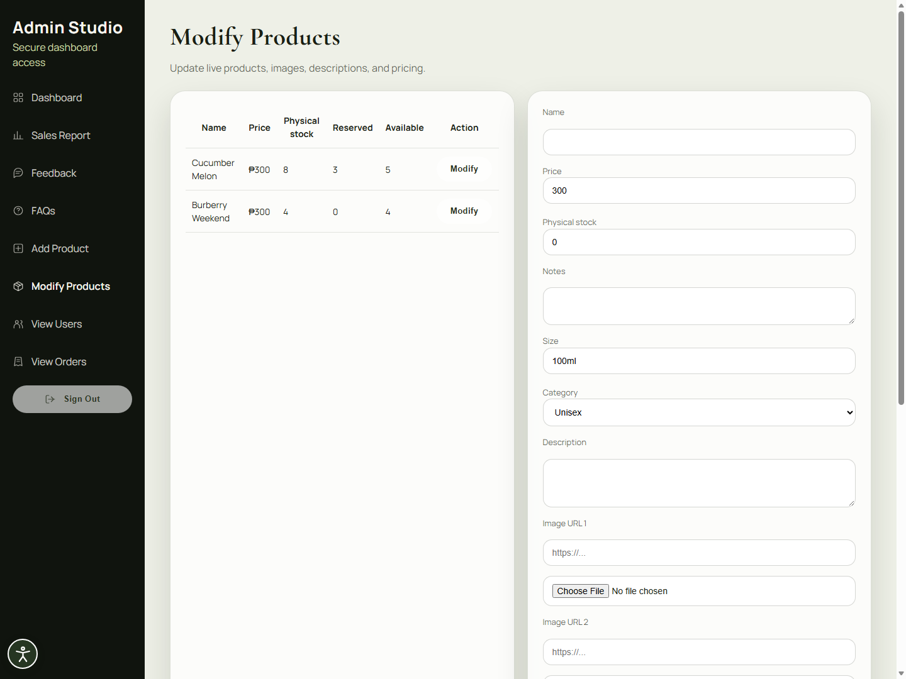

*Figure 14. Inventory management distinguishes physical stock, reserved commitments, and customer availability.*

### 12. Generate a sales report

1. Open **Sales Report**.
2. Review Gross collected, Verified refunds, and Net collected.
3. Choose a month or day to inspect verified collection and refund activity.
4. Select **Print PDF** and use the browser print dialog to save or print the report.
5. Check the dashboard for pending orders, unpaid orders, and canceled-order refunds awaiting confirmation.

Report dates use Philippine time and the verification date of each collection or refund. Historical order-placement entries require collection evidence before they contribute to verified sales.

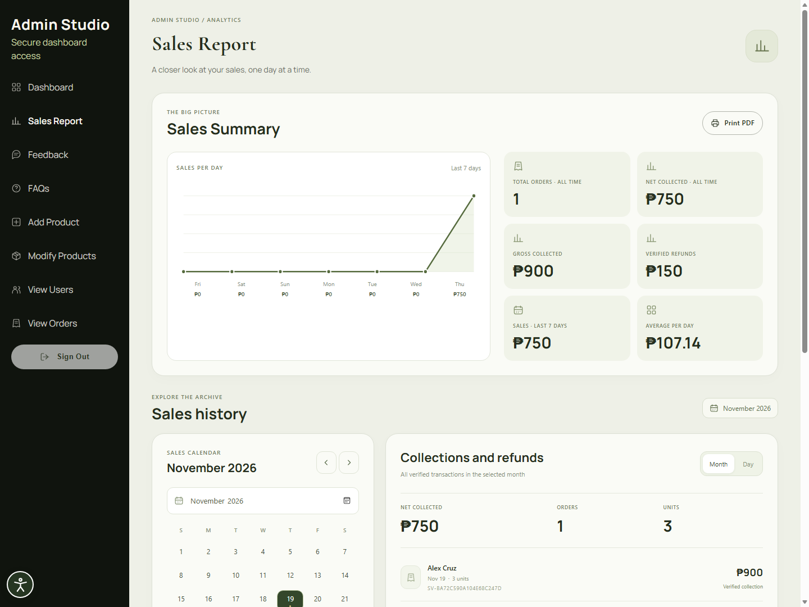

*Figure 15. Reporting distinguishes gross collections, refunds, and net collections.*

## Tablet and mobile use

The same procedures apply at smaller widths. Navigation collapses, cards stack, action groups wrap, and long tables scroll within their containers. Address and payment dialogs provide internal scrolling for their controls.

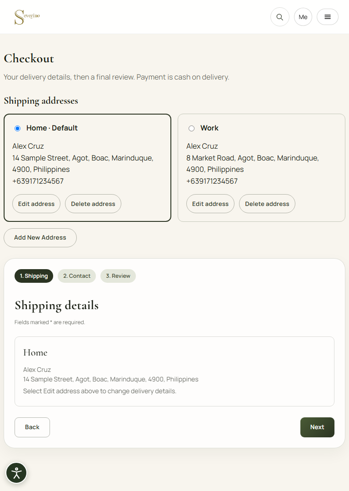

*Figure 16. Saved-address checkout at a 768-pixel tablet width.*

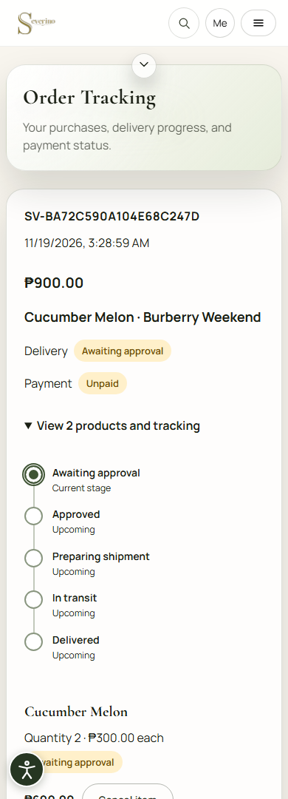

*Figure 17. Order-level tracking at a 390-pixel mobile width.*

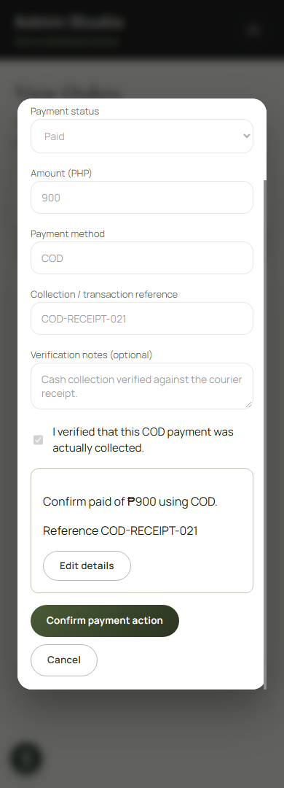

*Figure 18. Administrator payment review and confirmation on mobile.*
